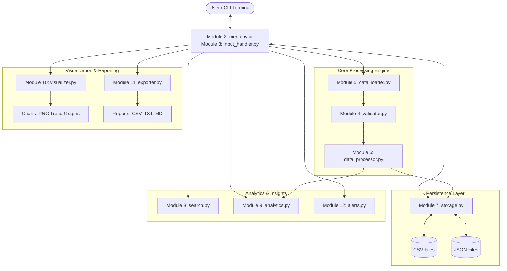
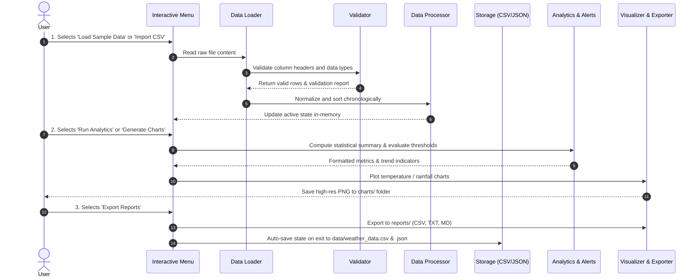

# Weather Data Visualizer - Project Architecture

## CampusSolve Project #91 | Data & Visualization

---

## 1. High-Level Architecture Overview

The **Weather Data Visualizer** is a modular Python CLI application designed for high reliability, extensibility, and zero external cloud dependency. It implements clean separation of concerns across 12 specialized modules.

---

## 2. Module Specifications

| Module | File | Responsibility |
| :--- | :--- | :--- |
| **Module 1: Main Application** | `main.py` | Initializes state, sets paths, loads stored records, and manages lifecycle. |
| **Module 2: Interactive Menu** | `src/menu.py` | Renders ASCII menus, tables with pagination, and dispatches options. |
| **Module 3: Input Handler** | `src/input_handler.py` | Safe terminal prompts with type casting, bounds checking, and graceful retries. |
| **Module 4: Validation Engine** | `src/validator.py` | Configurable range validation, date parsing, column checks, and record verification. |
| **Module 5: Data Loader** | `src/data_loader.py` | Reads external or sample CSVs, verifies headers, detects malformed rows. |
| **Module 6: Data Processor** | `src/data_processor.py` | Deduplication, type normalization, chronological sorting, and array extraction. |
| **Module 7: Storage Engine** | `src/storage.py` | Dual CSV/JSON persistence, backup generation, corrupted file recovery. |
| **Module 8: Search & Filter** | `src/search.py` | City substring search, date ranges, temperature and rainfall thresholds. |
| **Module 9: Analytics Engine** | `src/analytics.py` | Mean, min, max, rainfall sums, rainy day counts, and trend slopes. |
| **Module 10: Visualization** | `src/visualizer.py` | Matplotlib line/bar/comparison charts rendered with high DPI. |
| **Module 11: Report Exporter** | `src/exporter.py` | Compiles analysis and alerts into CSV, plain text, and Markdown reports. |
| **Module 12: Threshold Alerts** | `src/alerts.py` | Evaluates heatwaves, torrential rain, arid/muggy humidity, and sudden shifts. |

---

## 3. Data Flow Diagram

---

## 4. Non-Functional & Reliability Architecture

1. **Graceful Degradation**:
   - The application never crashes when encountering corrupted data rows or missing files. Invalid rows are recorded and reported to the user while valid rows continue to be processed.
2. **Configurable Thresholds**:
   - No arbitrary hardcoded meteorological limits. Valid temperature spans, wind speed bounds, and rainy-day definitions can be configured in `DEFAULT_CONFIG` or dynamically via Option 14 in the menu.
3. **Dual Persistence**:
   - Stores identical data in both CSV (`data/weather_data.csv`) for tabular spreadsheet portability and JSON (`data/weather_data.json`) for programmatic tree persistence.
4. **Resilient Matplotlib Engine**:
   - Configured with headless backend (`Agg`) ensuring charts can be rendered and saved cleanly on servers, CI pipelines, or local desktops without requiring a display server.
